Curry passed away on 2024 November 24.

Back in February, Curry almost died. She had stopped eating, stopped drinking,
and stopped moving. She just sat in her favorite chair (the papasan). She had a
routine checkup a week earlier where she looked totally fine. The vet diagnosed
her with pancreatitis and either IBD or lymphoma, a type of cancer.

<figure>
  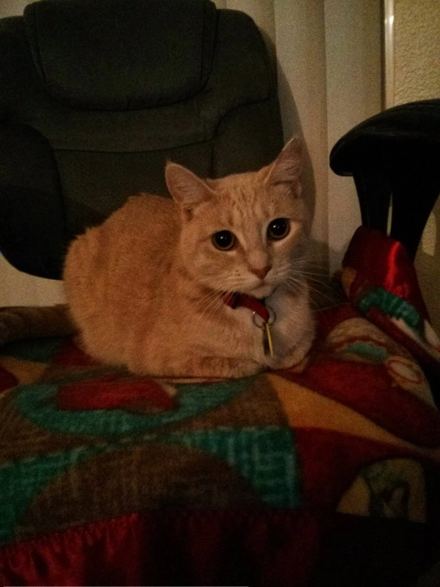
  <figcaption>One of the earliest pictures we have of Curry, taken a month after adopting her.</figcaption>
</figure>

She had always had minor issues with vomiting, especially after meals, but she
was an otherwise healthy cat. The vet prescribed prednisolone, a steroid, as the
primary drug to keep her comfortable for the rest of her life. We didn't choose
to have a biopsy performed to differentiate between IBD or lymphoma---because
it's invasive---and the treatment for both ailments is largely the same. The key
difference is how much longer she would live depending on which it was.

<figure>
  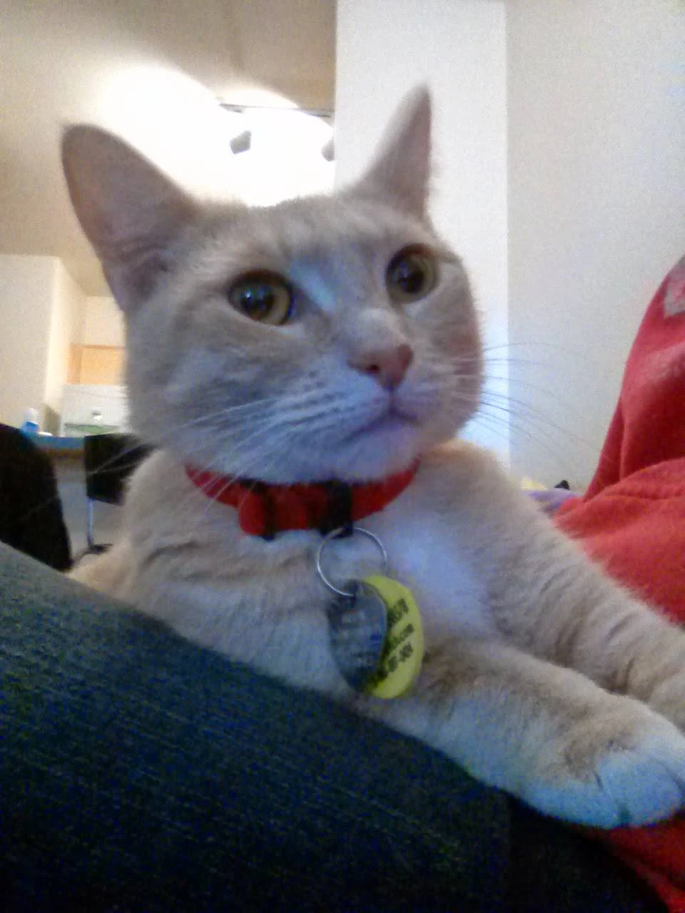
  <figcaption>January 2013, Curry displays her loved for sitting on people wearing denim.</figcaption>
</figure>

Curry was a very silly and spicy cat. She wasn't mean, but she liked to play
rough, and she wasn't one for cuddling. She did like sitting on laps, but pretty
much only if the person was wearing jeans lol. She would often sleep on Ash,
though. I think she was very picky about what fabric she sat on.

<figure>
  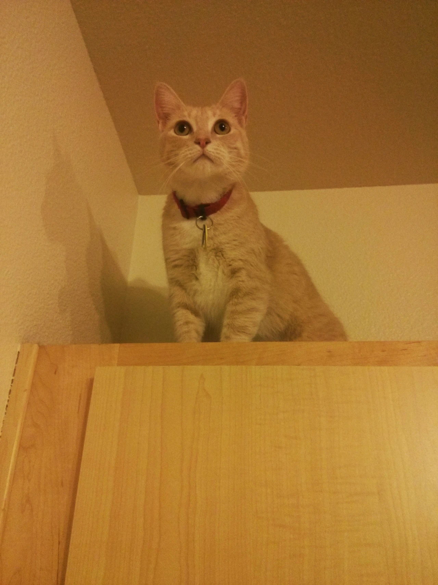
  <figcaption>When Curry was young and we still lived in our apartment, she would jump from the counter to the refrigerator and then run along the top of the cabinets.</figcaption>
</figure>

Ash and I adopted Curry in November 2012, when she was just a year and a half.
She had been surrendered to the Humane Society because her previous owner's
house burned down and they couldn't take care of her any more. Her name was
listed as "Shadow", which I had assumed was ironic.

<figure>
  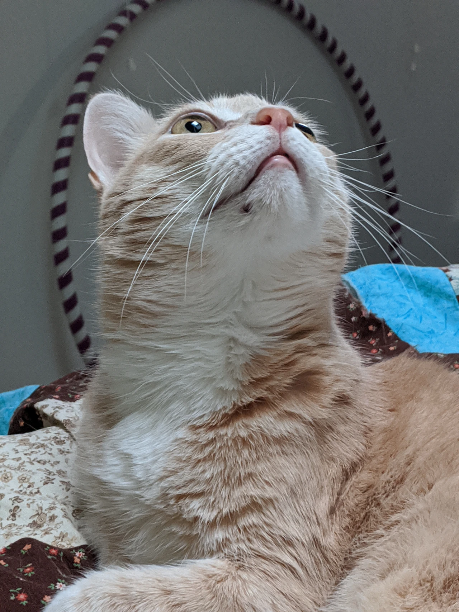
  <figcaption>Curry loved to stare up at the skylight in our bedroom&mdash;presumably at her own reflection&mdash;but we always said she was looking up at aliens.</figcaption>
</figure>

Well, "Shadow" was very clearly not an ironic name, but a behavioral one. She
followed me nearly everywhere I went, like a second shadow.

<figure>
  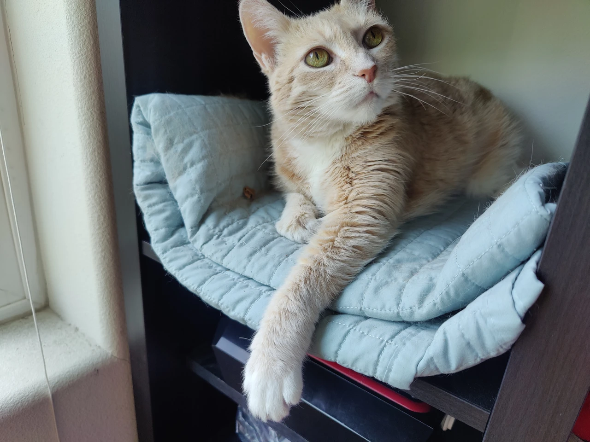
  <figcaption>I furnished this &ldquo;floor&rdquo; of my shelf with a blanket so Curry could relax on high with a window view while spending time with me in my office. She&rsquo;s doing a classic elegant pose, too.</figcaption>
</figure>

She was a ridiculously photogenic cat. For a while I ran a Twitter account just
for posting pictures of her. I even accidentally got the account locked by
entering her birthday, which prompted the "underaged account" lock process lol.
I had to send an image of my driver license to Twitter support to get them to
reinstate the account.

<figure>
  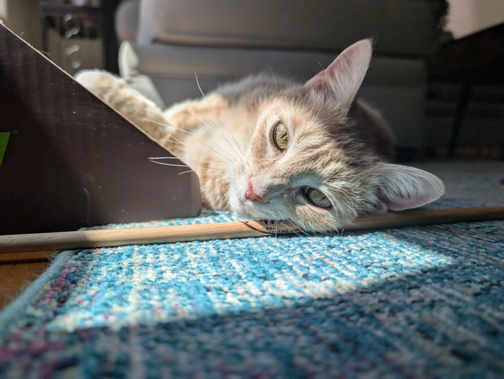
  <figcaption>Ever the sunbeam baby, her eyes are glowing in this picture.</figcaption>
</figure>

Curry was the first pet that Ash and I owned as adults living together. We
adopted her shortly after moving to Portland, Oregon in 2012. Originally I
wanted a black cat (since they're adopted less than other colors), but Curry
impressed herself upon us quickly.

<figure>
  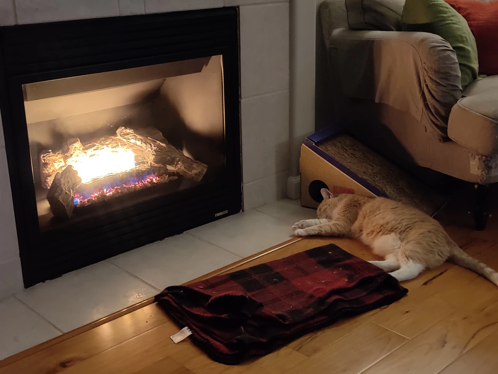
  <figcaption>Curry was only able to enjoy the fireplace for one Winter in our new house, as it currently needs to be fixed. She was glued to it while it was on, though. Cats love their heat sources.</figcaption>
</figure>

Curry was our only pet, and we will not be having children, so she was truly our
baby.

<figure>
  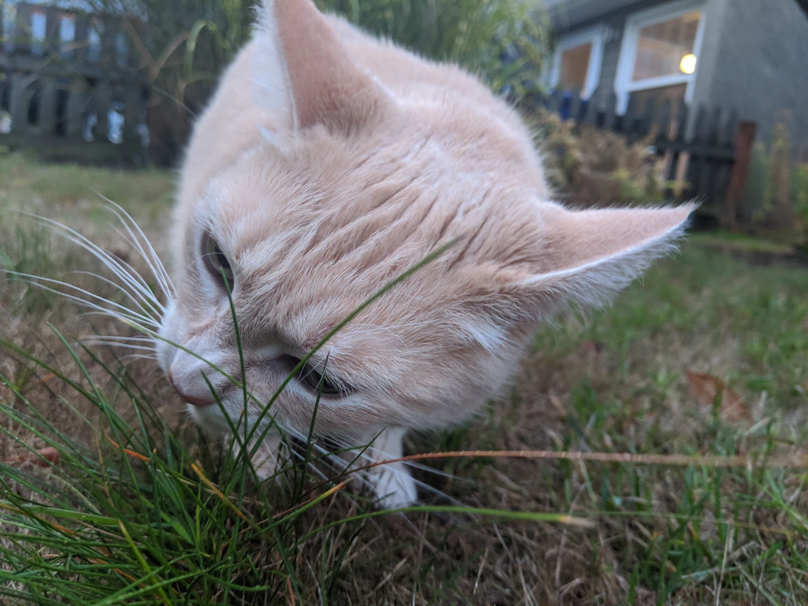
  <figcaption>Strangely, Curry was obsessed with eating grass. She didn&rsquo;t care about the outdoors much besides the ability to eat grass. She would throw it up, but she always wanted more.</figcaption>
</figure>

Curry loved us both so much. And we loved her so much. There's something so pure
about the love a pet has. Even when she was a stinker, you just know that cats
are inherently stinkers. They're just little guys. They're furry goblins. She
was our furry little goblin.

<figure>
  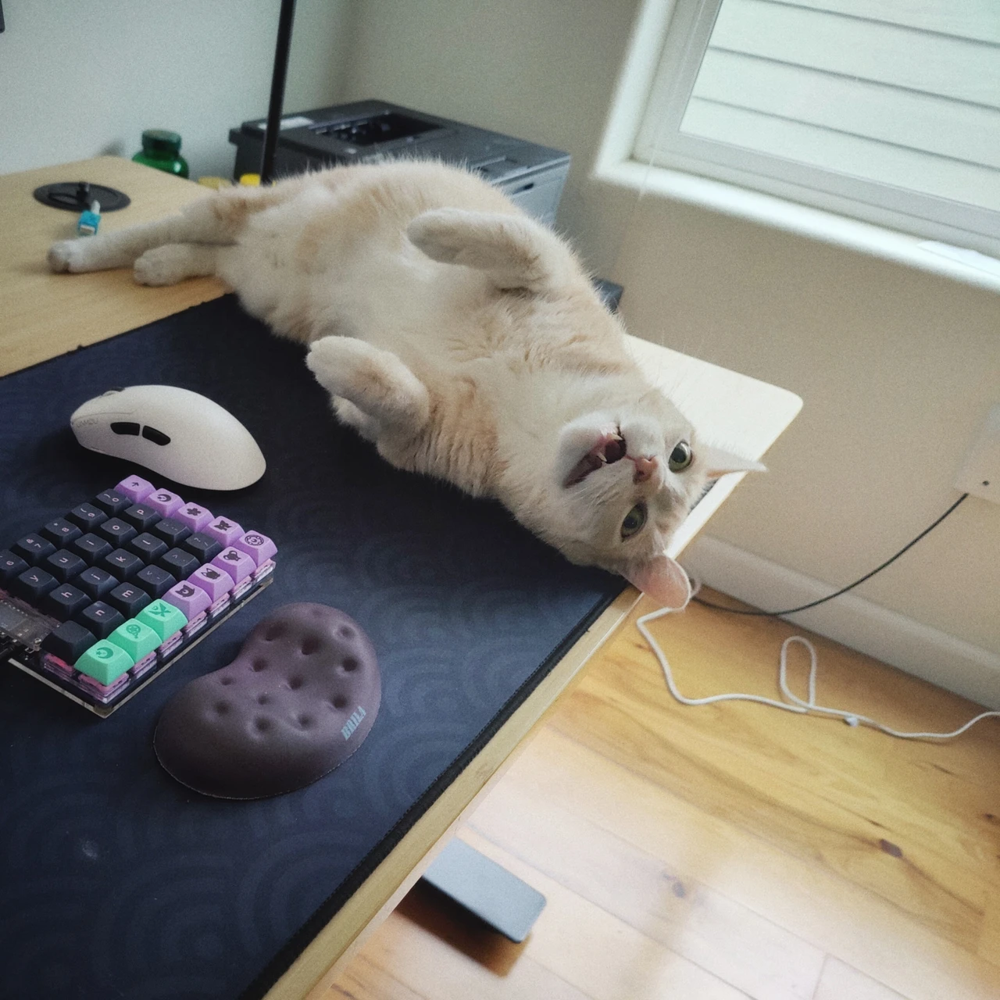
  <figcaption>Curry loved to lay on my deskpad, right next to my hand. She would nudge me, asking to be pet. She made such a mess of the fabric with her fur, but it was adorable how much she loved me and wanted my attention.</figcaption>
</figure>

Curry was virtually never interested in our human food, save for two exceptions.
She loved canned tuna, particularly the water in the can. She grew to know the
sound of cans being opened, and she was disappointed every time it turned out to
be beans or tomato paste or what have you.

<figure>
  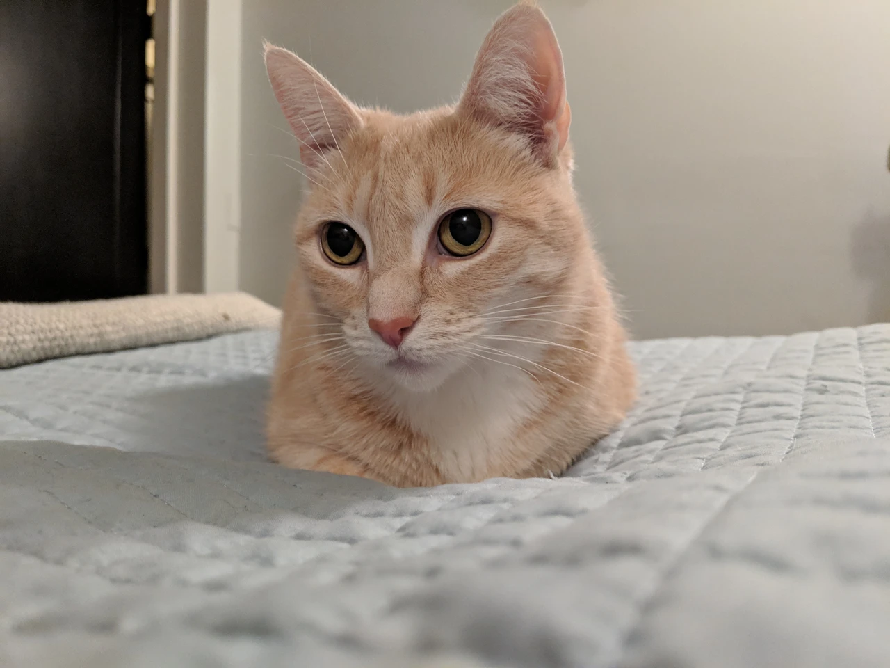
  <figcaption>I love how much fur detail was captured in this photo.</figcaption>
</figure>

The other human food she wanted was pork rinds. She actually tried to take a
bite of a pork rind once. I think it probably has a _bit_ too much salt for a
cat, so I never let her try it.

<figure>
  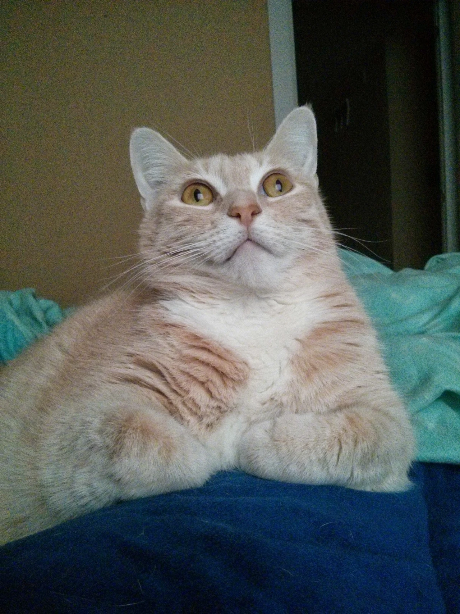
  <figcaption>This might be the silliest face she ever made.</figcaption>
</figure>

<figure>
  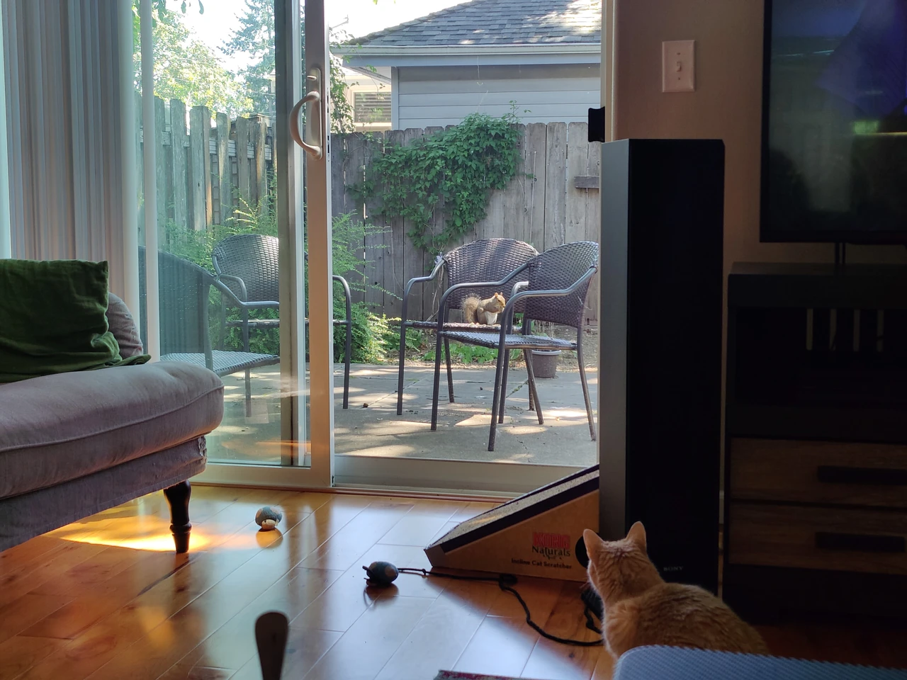
  <figcaption>Curry loved when I fed the squirrels. I trained the squirrels that it was safe to come near our screen door when it was shut, even when Curry was right on the other side. She even pounced at the door once lol.</figcaption>
</figure>

Curry was an indoor only cat, but we did let her outside with supervision
sometimes. She was mostly overwhelmed if I carried her anywhere beyond our yard.
Her real goal outside was eating grass. She would eat grass until she threw up.

<figure>
  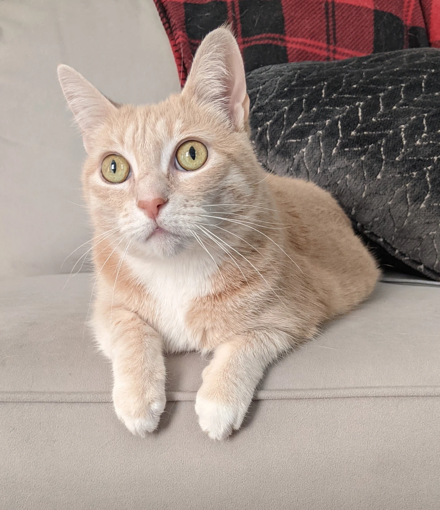
  <figcaption>Who knows what&rsquo;s she was staring at here.</figcaption>
</figure>

In the process of tidying up the house after Curry's passing, I realized that
every single room in the house had something of hers in it. A favorite spot to
sleep, a toy, or what have you.

<figure>
  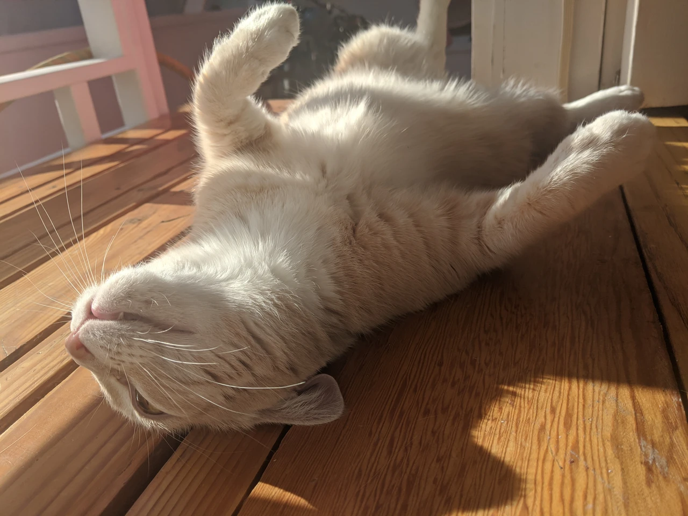
  <figcaption>Our old house had a sun room and Curry basically lived in that room.</figcaption>
</figure>

Here's a fun little story about Japanese grammar related to cats. I was talking
with my Japanese friend Shuji about cats when he told me this.

<figure>
  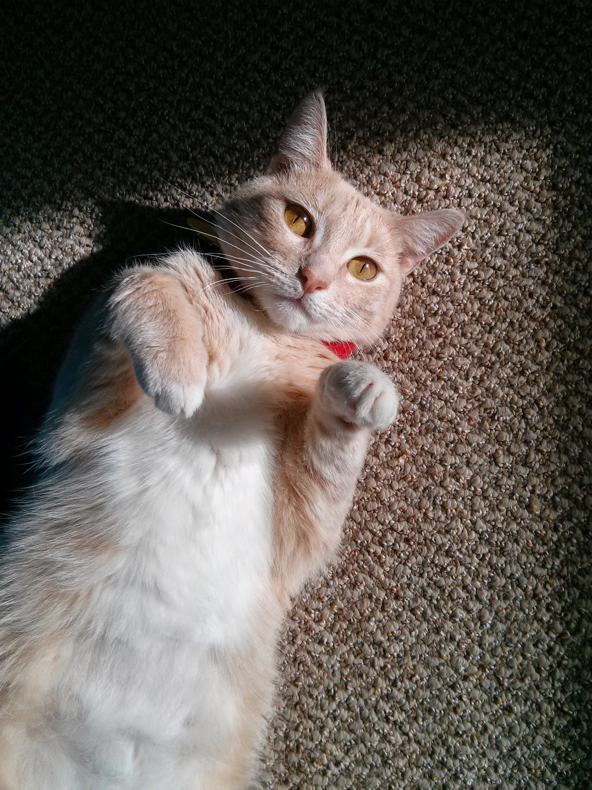
  <figcaption>An early photo of Curry showing off her classic pose. She loved to show me her tummy and paws.</figcaption>
</figure>

In Japanese, there's a concept of "counters", which are suffixes used with
numbers when counting different types of things. The counter for people
is 人 (_nin_), which is read
like １人 (_hitori_), ２人 (_futari_), ３人 (_san'nin_), ４人 (_yonin_), ５人 (_gonin_),
etc. For small animals the counter is 匹 (_hiki_), which is read
like １匹 (_ippiki_), ２匹 (_nihiki_), ３匹 (_sambiki_), ４匹 (_yonhiki_), ５匹 (_gohiki_)
etc.

<figure>
  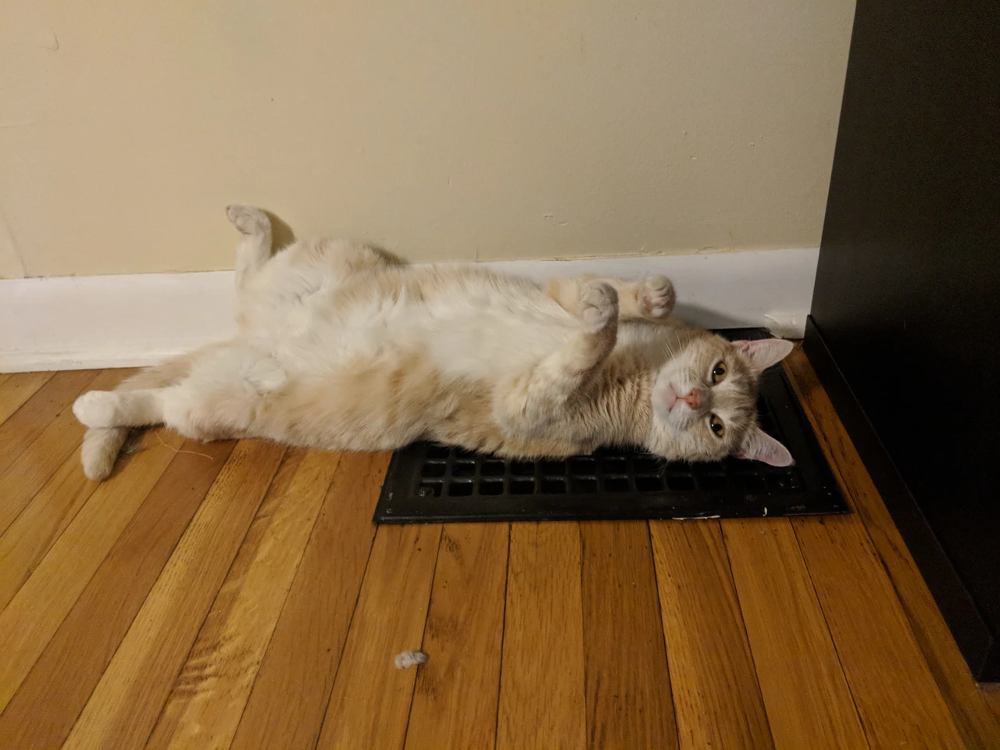
  <figcaption>Curry loved heat vents and posing for the camera.</figcaption>
</figure>

My friend had said something like 猫が２人いる (_neko ga futari iru_) to say he
has two cats, but that's the counter for _humans_. I asked him about it, and he
told me it's a vibes thing. It immmediately made sense to me. Cats aren't just
small animals, they're our family.

<figure>
  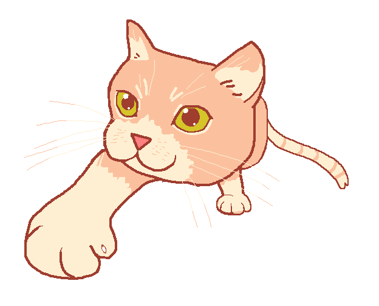
  <figcaption><a href="https://platinumtulip.net/">Tulip</a> was able to perfectly capture Curry&rsquo;s little goblin energy in this image.</figcaption>
</figure>

I was going through some old photos on my phone today and started crying look at
pictures of Curry. We have her ashes in a lovely urn shaped like a cat. We had
already collected a tuft of her fur a while ago, and we were able to find a
whisker and some claw fragments in the house. We're getting a memorial jar to
put those things in. We're also planning on framing her paw print along with a
photo of her.

<figure>
  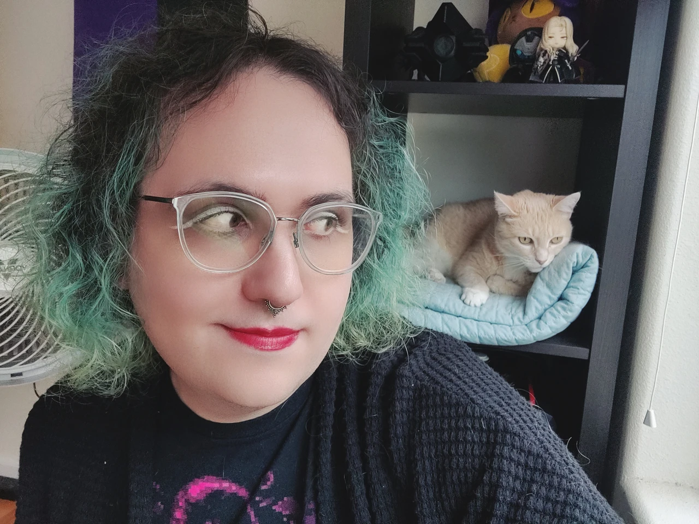
  <figcaption>I don&rsquo;t have very many good pictures of me and Curry in the same frame, but I like this one.</figcaption>
</figure>

Curry was a beloved member of our family for 12 years. We will love her forever,
and do what we can to preserve her memory. Thank you for reading this memorial.
