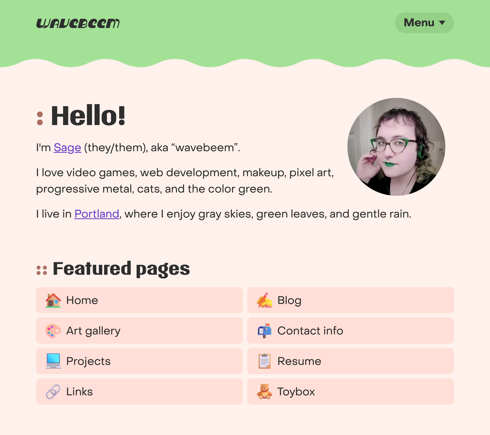
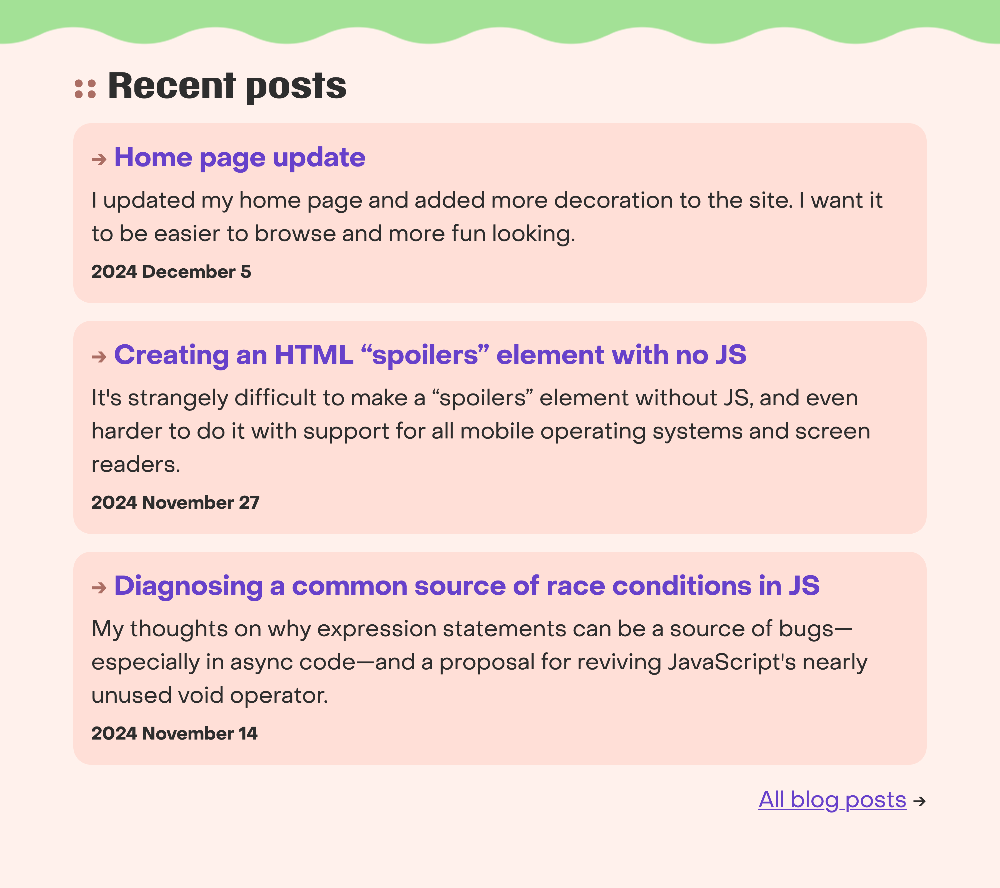
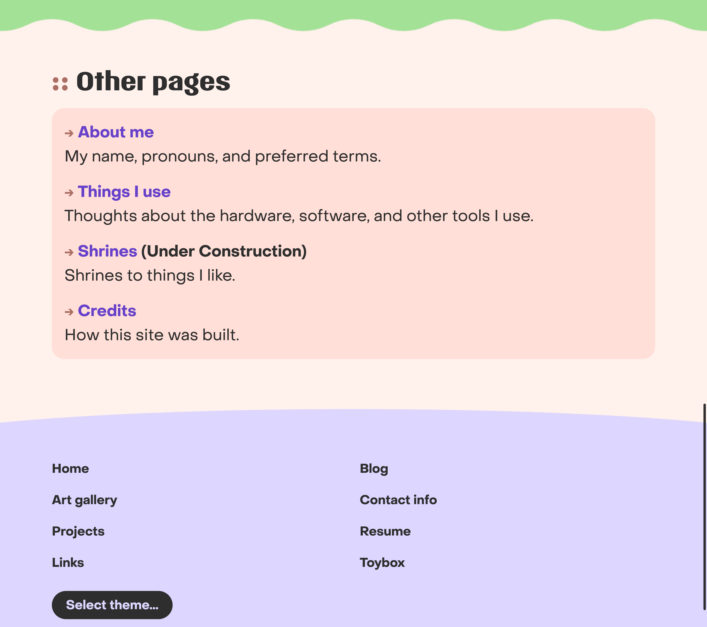
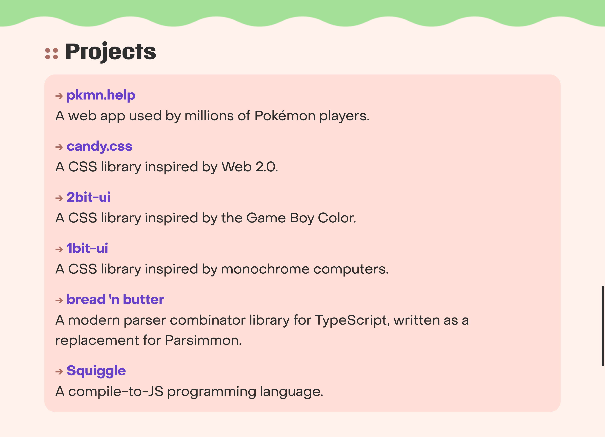
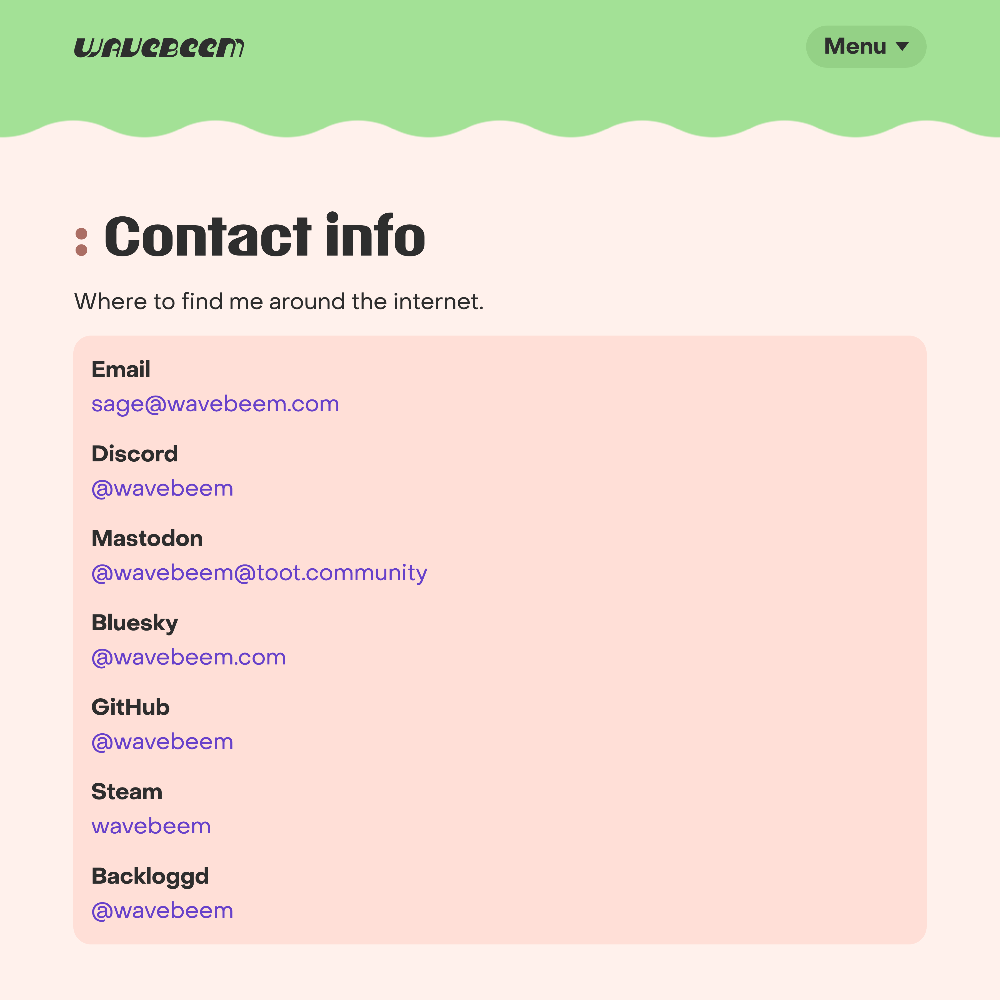

## Home page top

<figure>
  
</figure>

Headers now have little decorative text beside them. I shortened my menu to 8
pages, to keep things focused.

## Home page middle

<figure>
  
</figure>

I added an arrow decoration to blog post titles, making them look a bit more
clickable.

## Home page bottom

<figure>
  
</figure>

I added an "other pages" section, because it felt like a total mess to have
every single thing I want to link to in one giant list on the front of my home
page _and_ in the menu **and** in the footer on every page.

## Embracing lists

Rather than overusing tables and cards, I'm trying to remember to use the humble
[description list](https://developer.mozilla.org/en-US/docs/Web/HTML/Element/dl)
(`<dl>`) more.

<figure>
  
  
</figure>
