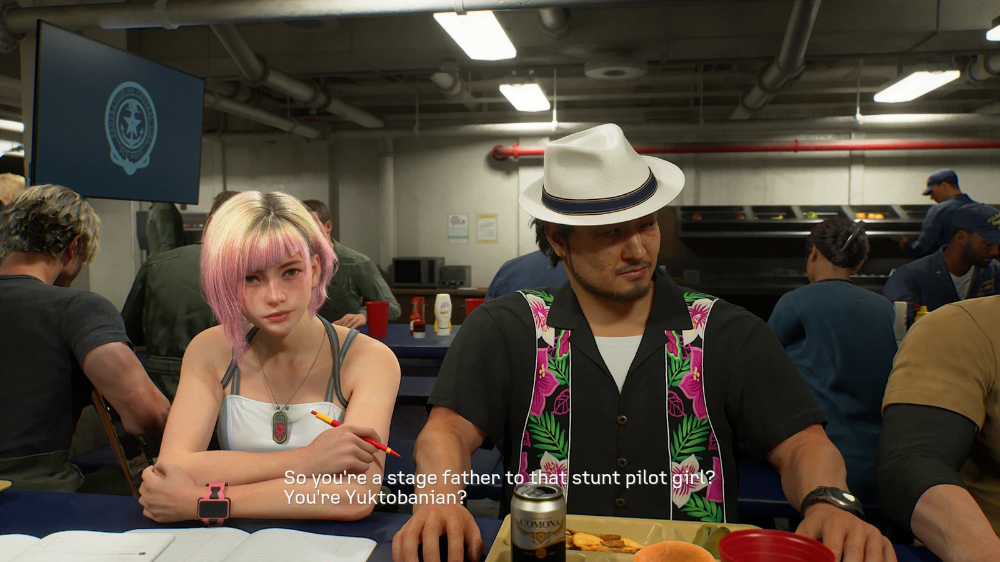
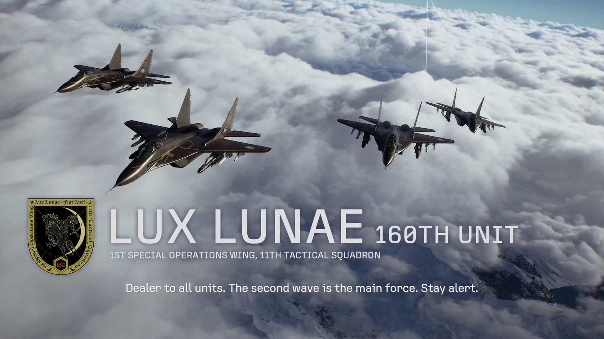
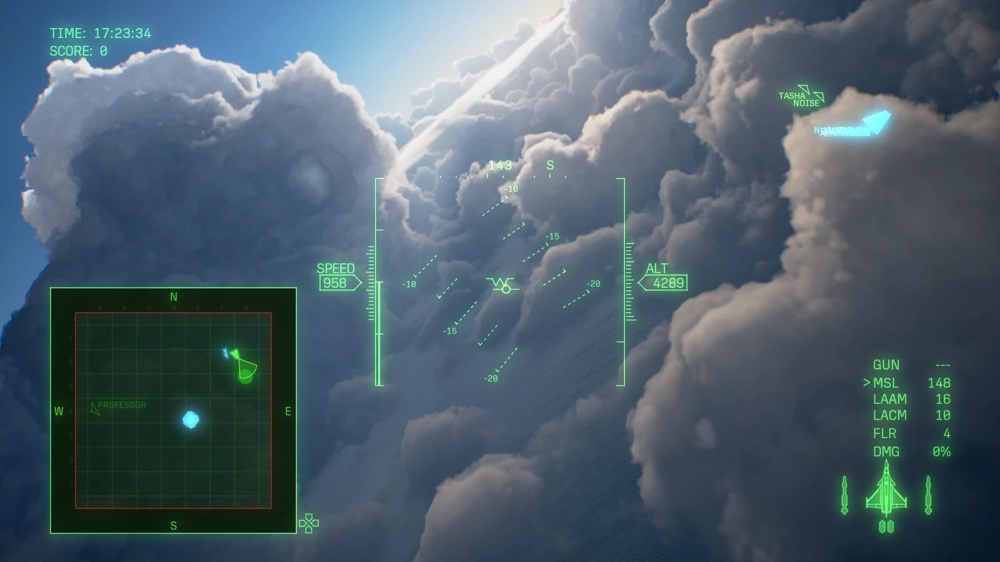
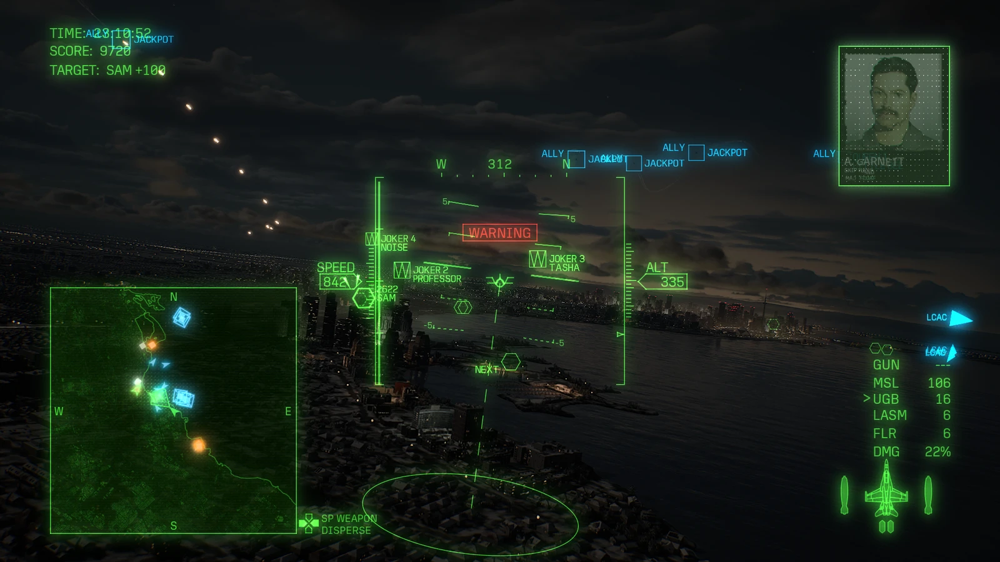

After 40+ hours, I finished
[ACE COMBAT 8: WINGS OF THEVE](https://store.steampowered.com/app/2288340/ACE_COMBAT_8_WINGS_OF_THEVE/).

I haven't felt this way about a video game in a long time. Ace Combat, I'm so
sorry we're just now meeting for the first time.

Being staunchly anti-war and anti-military nearly prevented me from playing
another one of my favorites:
[Spec Ops: The Line](https://en.wikipedia.org/wiki/Spec_Ops:_The_Line). Where
that game took a more gritty approach to "war is bad", Ace Combat is distinctly
"anime".

I made sure to play on "expert" controls, even though the learning curve was
brutal (and I'm still pretty awful at it), so I could maximize immersion. After
all, I played Microsoft Flight Simulator with a joystick as a kid. So... I'm
practically a certified pilot, right?

It's hard to decide where to start with this game. Perhaps the most striking
thing to me was how deeply immersed I became. Not only did time completely
disappear, but my pulse was racing during the intense dogfights and bombing
runs. Playing in first person and soaring through the skies is absolutely
gorgeous. But what stood out to me even more is the audio.

There's a _ton_ of voiceover work in this game, and everyone is acted well. As
overwhelming as it can be, absorbing so much information over the radio while
fighting was a great gameplay choice to keep the pace fast, and provide
contextually appropriate character development.

The sound design on the in-flight UI, the crackle and distortion of the comms,
enemies taunting you over open channels, the sound of missiles launching, allies
coordinating with you... there's so much audio information to take in, but
rather than feeling like a mess, it made me feel the chaos of battle. And it
really sold the stakes of the FCU reclaiming their capital: Theve.

The music is absolutely fantastic in this game, too. I hope I can see a full
track list at some point, because I can only imagine it's massive. I lost track
of how many unique songs I heard through the course of the game, setting the
tone perfectly. You know how in anime they'll change the opening song between
arcs/seasons of the show? That's how I felt with this game and its menu songs.
Plus they do great audio programming, fading in/out various instruments, giving
different parts of the menu a different vibe (e.g. purchase screen vs equip
screen vs select planes).

Maybe it's those thousands of hours of Destiny 2 in me, but I go feral for
[leitmotifs](https://en.wikipedia.org/wiki/Leitmotif) and recurring themes in
music. The main antagonist force of the game, the _Lux Lunae_, have their own
recurring chorus they play over open comms channels. This intimidation tactic
also serves as a type of boss music, but it's fucking
[diegetic](https://en.wiktionary.org/wiki/diegetic#English). I'll keep this
vague to avoid spoilers: at a certain point in the game, you hear this song
again, but with a vocal solo rather than a chorus. This kind of trick gets me
every time in media :)

Oh, and in case it's not clear: I thought the game was really fun, too. Even if
I'm still quite clumsy (do not watch me try to dogfight with machine guns, ugh).
Pulling off my first tunnel run was an exhilarating experience.

The story... was definitely the most unexpectedly good part for me. I thought I
was going in for an action movie with an amazing soundtrack, but I ended up in
tears at multiple points. There's just enough time and characterization to make
the losses you sustain **really hurt**. The game is also very... anime in tone,
world, etc. Everyone is taking everything seriously, but it's just a little over
the top and unrealistic in a way that's really fun.

Ace Combat 8 was my first in the series, but it definitely won't be my last!

## Special thanks

**Anna:** Thank you for encouraging me to try this game, and for coaching me
through an early mission when I was struggling. It was a distinct pleasure
finally getting to share the joy of this series with you.

**Tony:** You sharing your passion for the music of this series was instrumental
in me finally giving it the time of day. Thank you for consoling me after I
finished bawling my eyes out while playing this game.

## Screenshots

<figure>
  
  <figcaption>Tasha! My favorite character. Just don't tell Teach or Kate I said that...</figcaption>
</figure>

<figure>
  
  <figcaption>Tell me this isn't anime as hell, especially with a diegetic theme song</figcaption>
</figure>

<figure>
  
  <figcaption>This game is absolutely gorgeous, especially above the clouds</figcaption>
</figure>

<figure>
  
  <figcaption>Defending a city feels... so reactive and tense in this game</figcaption>
</figure>
