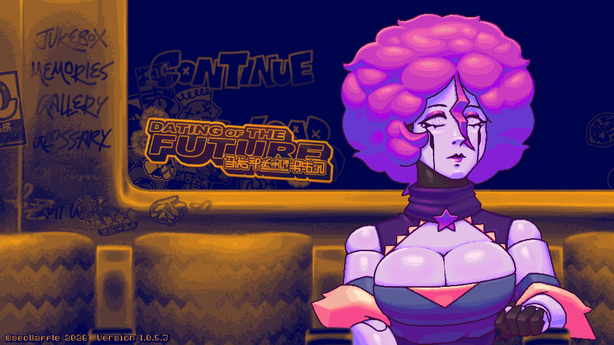
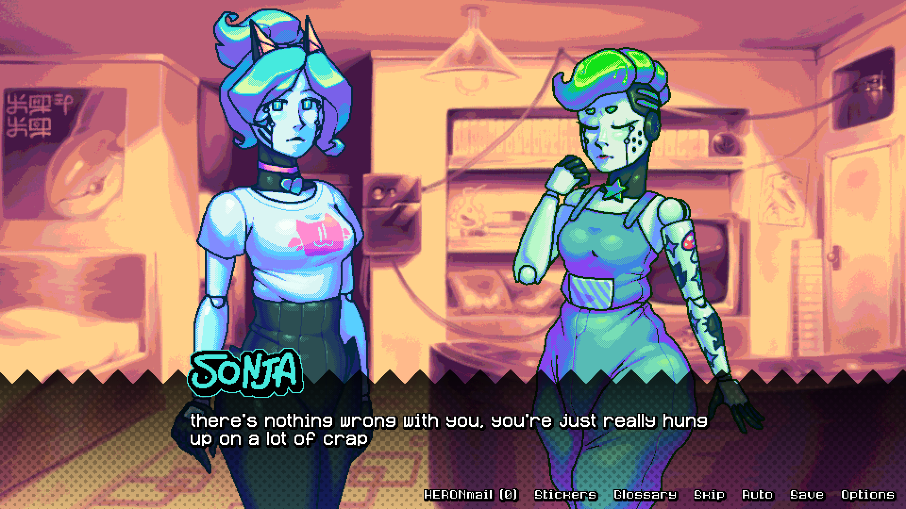
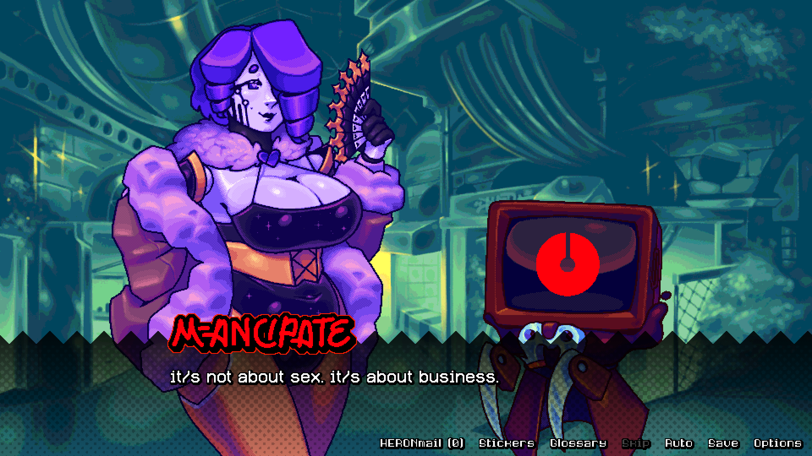
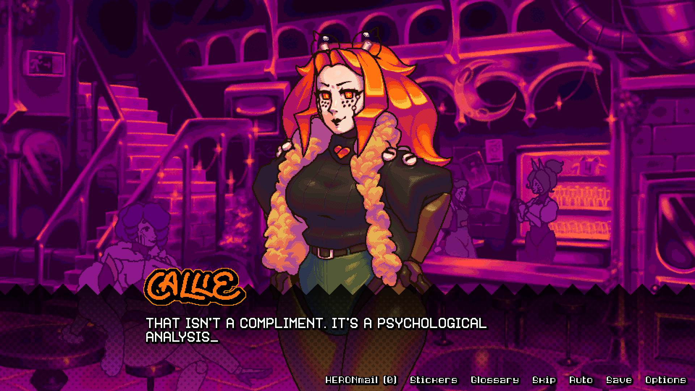
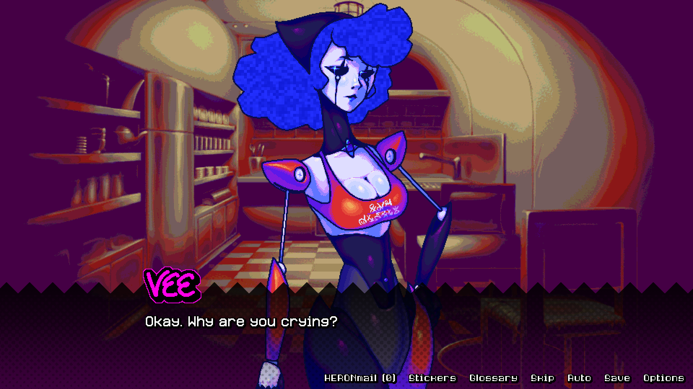

In 🔞
[**Dating of the Future**](https://store.steampowered.com/app/2928900/DATING_OF_THE_FUTURE/),
you play as Vee, a camerawoman turned pornographic actress who's trying to get
her new career off the ground.

The first half of the game feels like a slice-of-life story about you hanging
out with your friends and shooting new videos. And mostly just the hanging out
with friends part. If you're seeking titillation, go somewhere else. It's here
and it's good, but it's not the focus of the game.

I will admit that while I found the author endearing, the art immaculate, and
[the soundtrack](https://matthewoliver.bandcamp.com/album/spectrasound) next
level... It wasn't exactly a page turner for me yet. Everything changed in the
latter half of the game, though.

Here's a vague description: a new character shows up, and the stakes are
immediately raised. The entire tone of the game shifts. This is when I locked
the fuck in on finishing the game. After that arc ends, there's some really
heavy relationship drama with the last two character arcs. It's juicy shit, and
where the tears started pouring for me.

Mel's arc is just... deeply upsetting. Her problems feel too real. And the way
your extended friend group handles it is just perfect.

Callie's route is---well, fucked up. It's an interesting philosophical question,
I suppose. The way she handles things (very poorly) makes it worse (in a good
way). It's mess. If you love mess, you'll be eating good.

I saw something of myself in Vee---her empathy and selflessness (to a reckless
degree). And it made her part of the story stick with me, despite my initial
assumption that she was going to be more of a vehicle for other people's
stories.

Now go listen to
[the soundtrack](https://matthewoliver.bandcamp.com/album/spectrasound)!

---

🔍 _Click to enlarge images_

<figure>
  
  <figcaption>I always appreciated the game opening with a close up of Vee, since you don't see her much during gameplay.</figcaption>
</figure>

<figure>
  
  <figcaption>A perfect summary of a lot of your friends in this game&mdash;they're just really hung up on a lot of crap.</figcaption>
</figure>

<figure>
  
  <figcaption>Plenty of the citizens are <strong>not</strong> former sex robots. But few of them get much screen time besides this cute little wannabe capitalist goon.</figcaption>
</figure>

<figure>
  
  <figcaption>Callie, my favorite! ALL CAPS suits her well. She never fails to give her two cents on your life.</figcaption>
</figure>

<figure>
  
  <figcaption>Mel is the queen of hot mess on Spectra Star.</figcaption>
</figure>
